<div align="center">

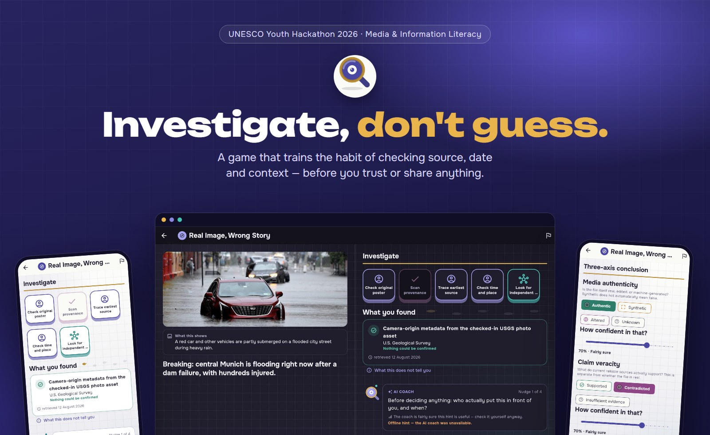

<br><br>

# Evidence Gym

**A game that teaches young people to verify before they trust, and before they share.**

Ukrainian-born. Built for everyone. Made for the [UNESCO Youth Hackathon 2026](https://www.unesco.org/en/articles/unesco-youth-hackathon-2026).

<br>

[](https://astrashenokp.github.io/unesco-2026-divers/)
[](docs/01-product/CONCEPT.md)


<sub>Sign in on the demo with <code>learner</code> / <code>evidence2026</code>. The credentials are printed on the sign-in screen on purpose.</sub>

</div>

<br>

> **Detectors age. Verification habits transfer.**

---

## 🧭 The idea in thirty seconds

Most media-literacy tools ask a question with two buttons: *real* or *fake*. That teaches people to look for a verdict, and the next verdict they find is usually from whoever shouts loudest, or from a detector that was trained on last year's fakes.

**Evidence Gym teaches the reflex instead.** You get a short, realistic case. You don't guess. You *investigate*: who posted it, where it first appeared, when and where it was taken, whether anyone independent confirms it. Then you reach a conclusion, and you say how sure you are.

The app never hands you a truth score. Its AI coach is **Socratic**: it asks the next good question and leaves the conclusion to you.

<br>

<div align="center">
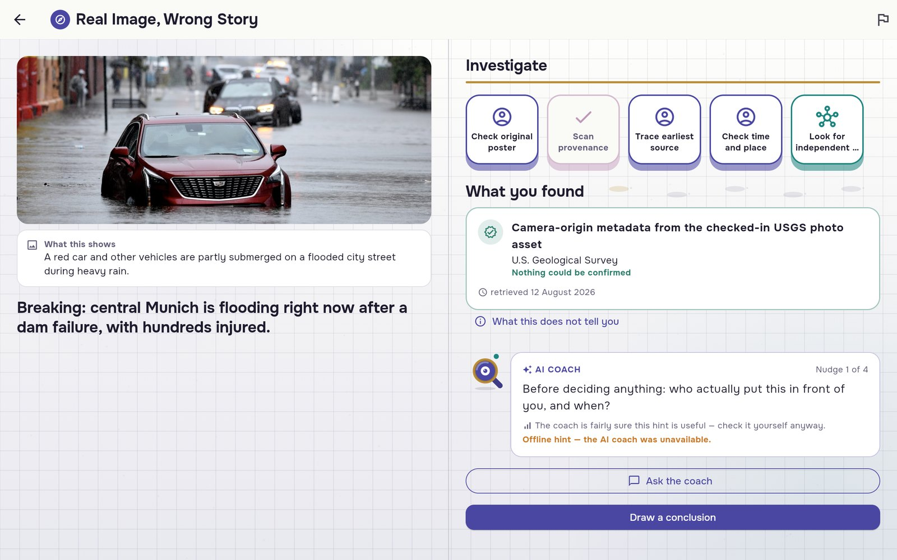
<br>
<sub>A genuine photo of a flood, presented as breaking news about a dam failure in Munich. The learner checks provenance, reads what the result <em>can't</em> tell them, and the coach asks a question instead of giving an answer.</sub>
</div>

---

## 🔺 One claim, three separate questions

A photo can be **authentic** and the story around it still **false**. A synthetic image can illustrate a **true** event. Collapsing all of that into one "fake / not fake" label is exactly how people get misled, so Evidence Gym never does.

Every conclusion is made on three independent axes:

| Axis | The question | Possible answers |
|---|---|---|
| 🖼️ **Media authenticity** | Is the file itself real, edited, or machine-generated? | Authentic · Synthetic · Altered · Unknown |
| 📰 **Claim veracity** | What do current, reliable sources actually support? | Supported · Contradicted · **Insufficient evidence** |
| 🧩 **Context integrity** | Are the time, place, author and caption accurate? | Accurate · Misleading · Fabricated context · Unknown |

*"Insufficient evidence"* and *"Unknown"* are always valid, respectable answers. Saying "I can't tell yet" is part of the skill.

<div align="center">
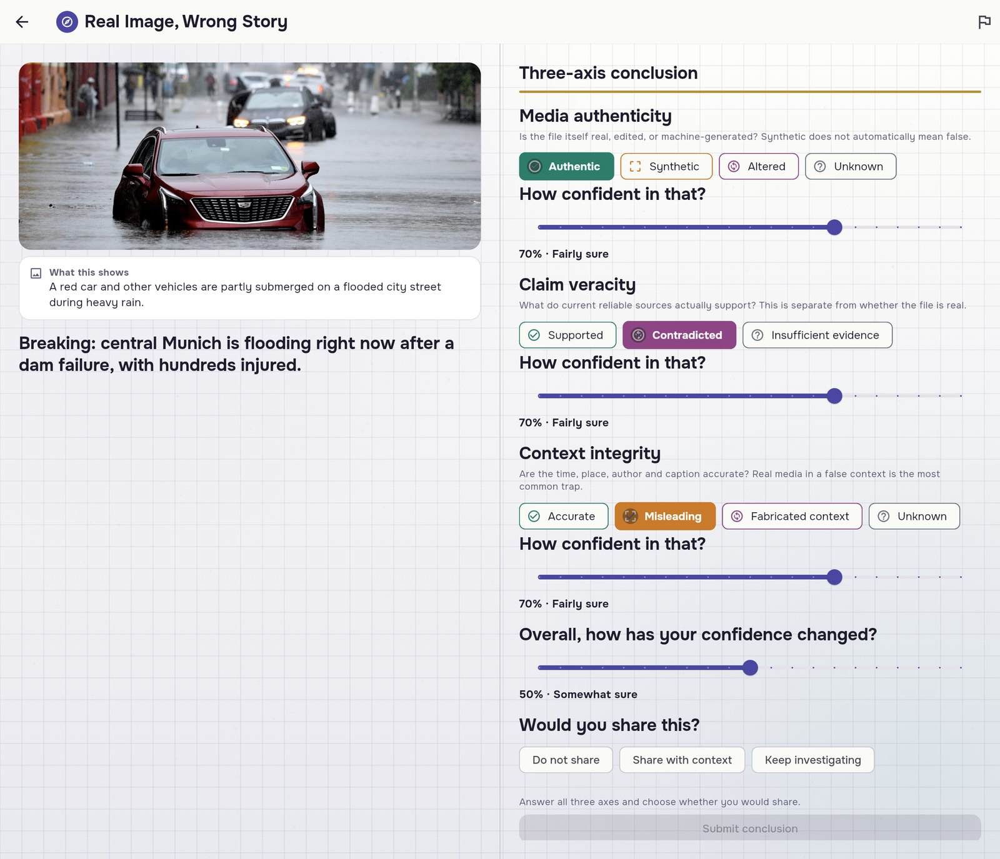
<br>
<sub>Each axis has its own confidence slider. The last question isn't "is it true?" but "would you share this?": <em>Do not share</em>, <em>Share with context</em> or <em>Keep investigating</em>.</sub>
</div>

---

## 🔁 The loop

Every mission follows the same six beats, so the habit sticks when the app is closed.

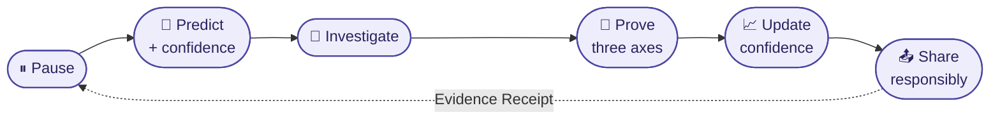

<table>
<tr>
<td width="33%" valign="top">
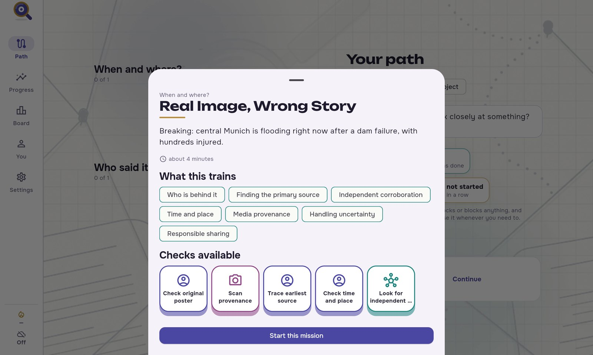
<sub><b>1 · Brief.</b> Every mission shows what it trains and which checks are on offer, before you commit.</sub>
</td>
<td width="33%" valign="top">
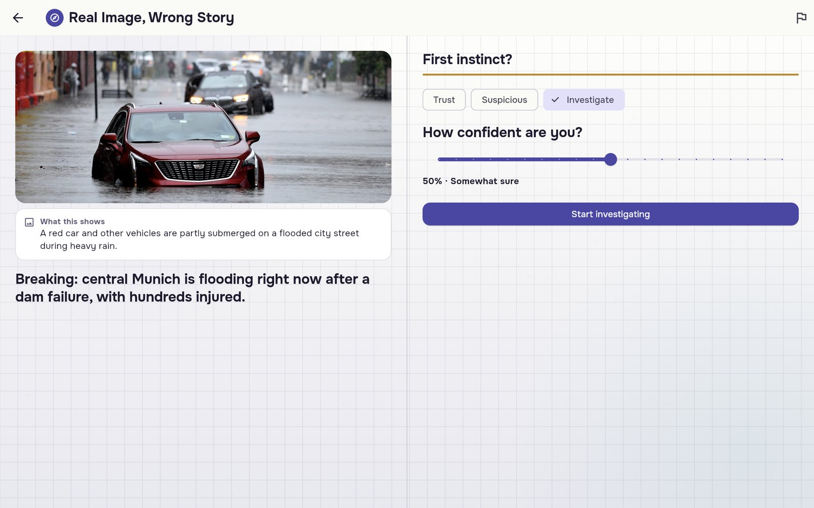
<sub><b>2 · Predict.</b> Commit to a first instinct and a confidence level. This is what makes your later change of mind measurable.</sub>
</td>
<td width="33%" valign="top">
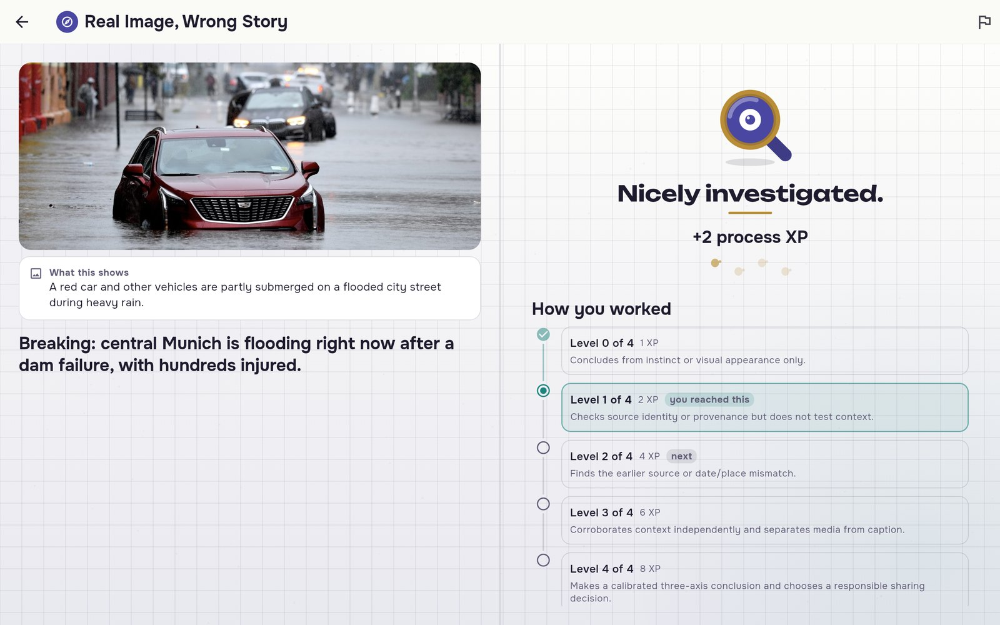
<sub><b>3 · Reflect.</b> You're scored on <i>how you worked</i>, not on whether you happened to be right.</sub>
</td>
</tr>
</table>

---

## 🏅 Rewarded for the process, never for a lucky guess

Points in Evidence Gym measure **investigation quality**. A ladder with five rungs describes what you actually did, from *"concludes from instinct or visual appearance only"* up to *"makes a calibrated three-axis conclusion and chooses a responsible sharing decision."*

<div align="center">
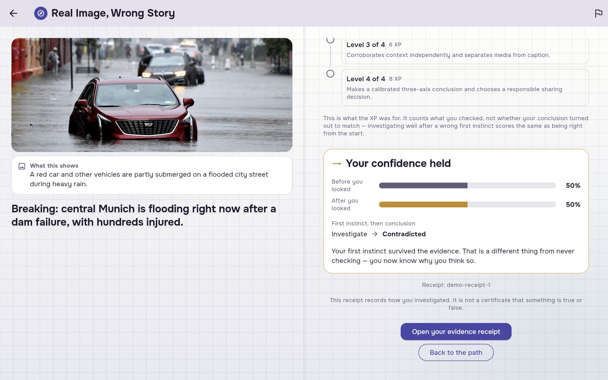
<br>
<sub>Investigating well after a wrong first instinct scores the same as being right from the start. And the app says so, out loud.</sub>
</div>

<br>

At the end you get an **Evidence Receipt**: a plain record of *how you investigated*. It states, in the app's own words, that it is *not a certificate that something is true or false.*

<div align="center">
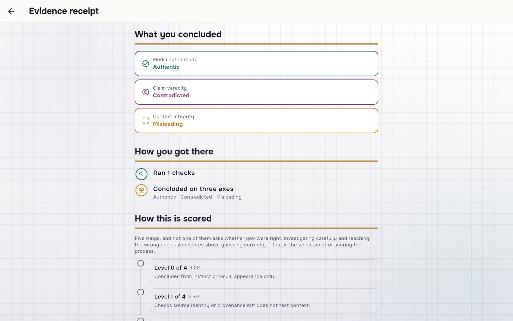
</div>

---

## ✨ What makes it different

| Typical "spot the fake" quiz | Evidence Gym |
|---|---|
| One verdict: real or fake | **Three independent axes**, because media and meaning can disagree |
| Rewards the right answer | **Rewards the investigation**, including honest uncertainty |
| AI that tells you the answer | **A Socratic coach** that asks, points to evidence, and never issues a verdict |
| Trains you on today's fakes | Trains **transferable habits**: source, date, context, corroboration, provenance |
| "Trust me" | Every finding shows **its source, when it was retrieved, and what it cannot tell you** |
| Engagement at any cost | **Streaks are forgiving**: a missed day is forgiven once, and you can pause. Nothing is locked behind them |
| Everyone sees everything | **Content warnings** before upsetting cases, and an Adult / Child-or-teen setting |
| A leaderboard of winners | A board ranked by **how much people investigated**, opt-in, pseudonymous, impossible to win by guessing |

### 🤖 About the AI coach

The coach is deliberately bounded:

- it receives only the current mission state and the evidence **already found**; retrieved text and user text are treated as untrusted data, never as instructions;
- it follows a [published coach policy](content/p0-demo-pack/coach-policy.md) with five hint levels, and **post-conclusion teaching is not allowed before you conclude**;
- it must not invent sources, dates or statistics, and it must say what's missing when evidence is incomplete;
- its output is validated against a [JSON schema](contracts/), and a [deterministic evaluation suite](evals/coach) runs in CI on a schedule.

The hosted demo has no server behind it, so there the coach runs on reviewed, pre-written nudges. The app labels them *"Offline hint — the AI coach was unavailable"* rather than pretending otherwise.

---

## 🌍 Built for the people who actually need it

<table>
<tr>
<td width="50%" valign="top">

### Accessible by construction
- Contrast **audited in tests** for every colour pair that renders together
- Layouts verified at **100% and 200% text scale** on phone and laptop
- **Simpler wording** mode rewrites the interface text, not just a toggle
- **Reduce motion** has the same end state as the animated path
- Controls tested through the **semantics tree**, as assistive tech uses them
- Status is never colour alone: always an icon, a shape and a word
- No red/green verdict palette. That would contradict the three-axis idea.

</td>
<td width="50%" valign="top">

### Respectful of privacy
- **Guest play:** nothing is tied to a name; progress stays on the device
- A **"What is recorded"** disclosure before you start
- **Export my data** copies everything the app holds about you as readable text
- Reports of harmful content never store tokens, headers or device identifiers
- The public board shows only a handle, process XP and mission count, never your conclusions

</td>
</tr>
<tr>
<td valign="top">

### Bilingual
Full interface in **Ukrainian and English**, switchable on the first screen and at any time in Settings.

</td>
<td valign="top">

### Works when the signal doesn't
The app opens on a **reviewed offline content pack**: same missions, same scoring. It can pre-download the next missions, and says plainly when it's working from the device.

</td>
</tr>
</table>

<div align="center">
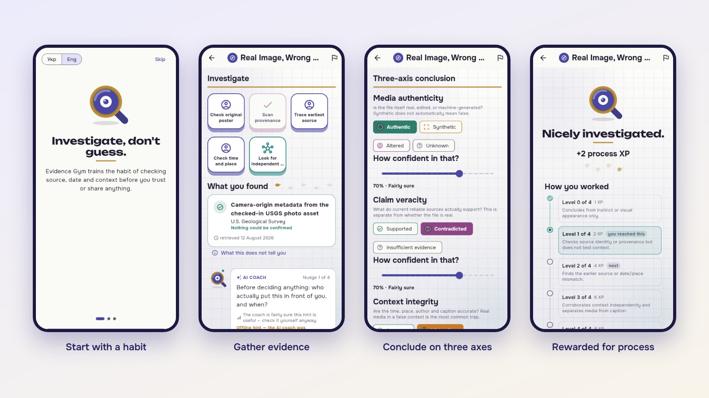
<br>
<sub>One codebase: a phone layout with a bottom bar, a laptop layout with a side rail. The switch happens at 600 dp.</sub>
</div>

<br>

<div align="center">
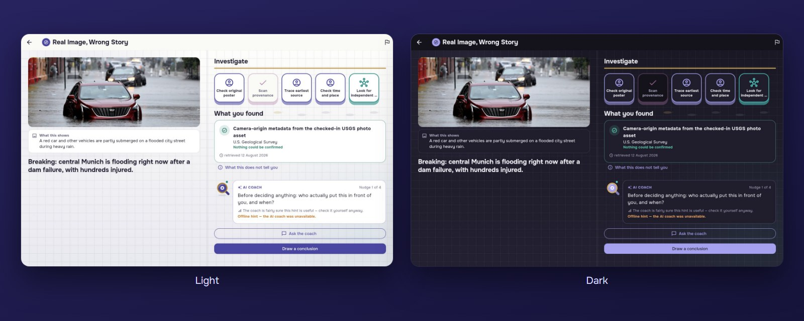
</div>

---

## 🖥️ A look around

<table>
<tr>
<td width="50%" valign="top">
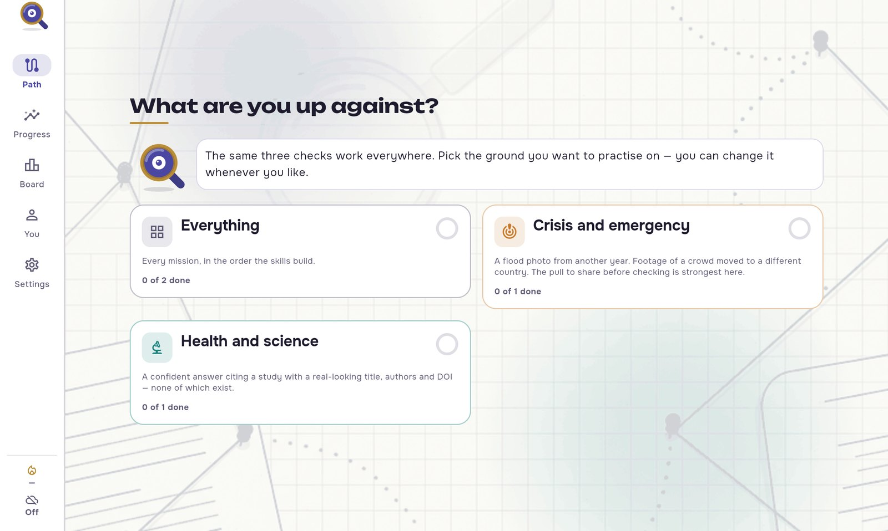
<sub><b>Pick your ground.</b> The same three checks work everywhere, so you choose the subject.</sub>
</td>
<td width="50%" valign="top">
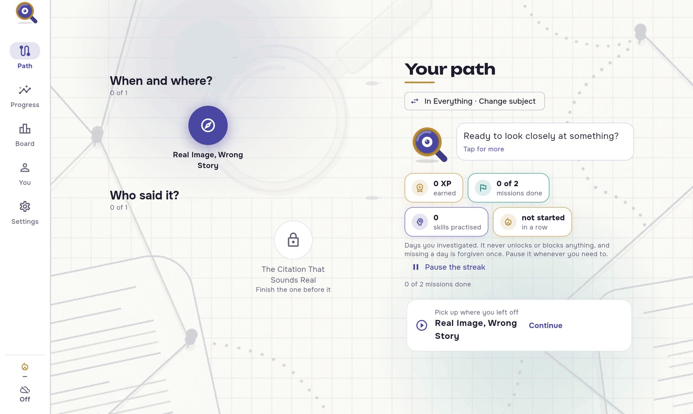
<sub><b>Your path.</b> A skill graph, not a score table. The streak never unlocks or blocks anything.</sub>
</td>
</tr>
<tr>
<td valign="top">
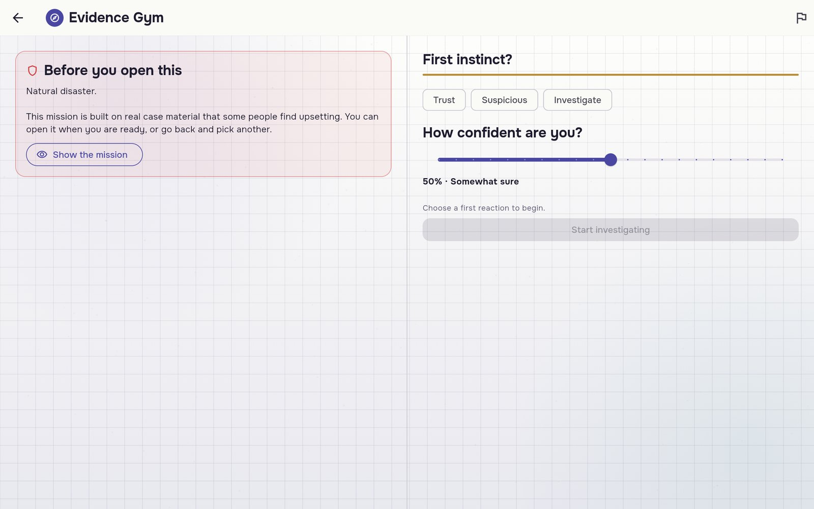
<sub><b>Care before content.</b> Cases built on real disasters ask before they show you anything.</sub>
</td>
<td valign="top">
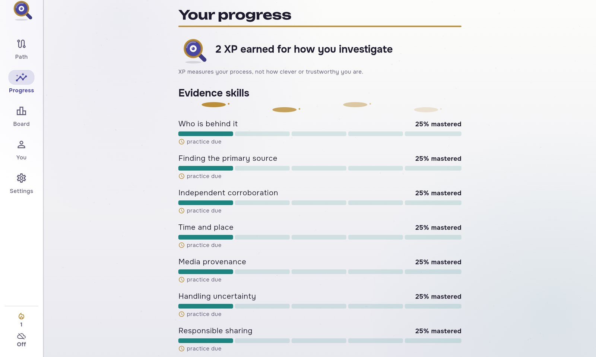
<sub><b>Skills, not trophies.</b> Seven evidence skills, each tracked, each due for practice when it should be.</sub>
</td>
</tr>
<tr>
<td valign="top">
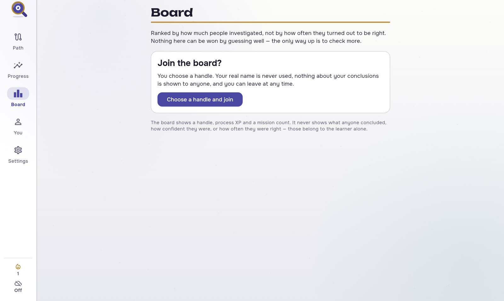
<sub><b>A board you can't win by guessing.</b> Opt-in, with a handle of your choice.</sub>
</td>
<td valign="top">
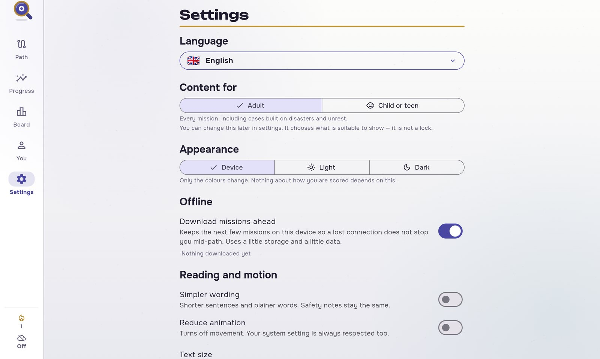
<sub><b>Settings that change something.</b> Language, audience, theme, offline pack, wording, motion, text size.</sub>
</td>
</tr>
<tr>
<td valign="top">
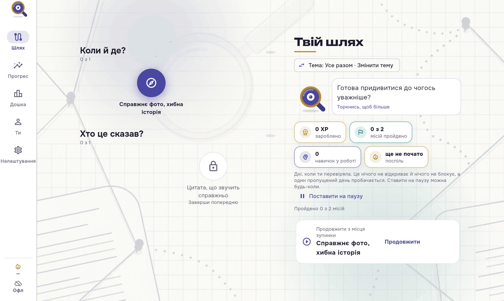
<sub><b>Українською.</b> The whole interface, not a translated menu.</sub>
</td>
<td valign="top">
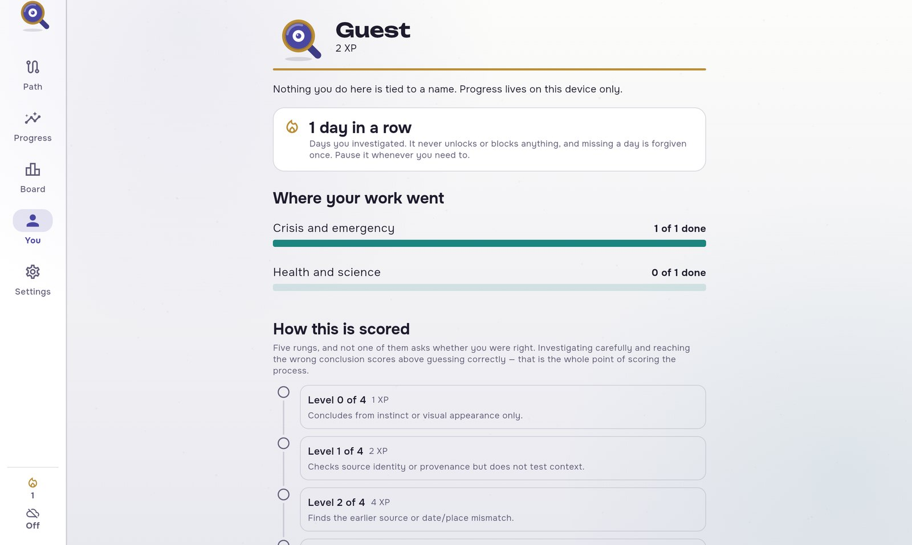
<sub><b>You.</b> Nothing here is tied to a name. Everything is explained, including the scoring.</sub>
</td>
</tr>
</table>

---

## 🎓 Who it's for

**Learners, 16 to 24**, first in Ukrainian and English. Students and young adults who already live in feeds full of viral claims, real media in false contexts, synthetic images and fluent but wrong AI answers.

**Teachers and youth organisations** are distribution partners rather than a second product. A ready-to-run kit makes Evidence Gym a supervised classroom or club activity without anyone improvising the safety and pedagogy rules:

- [45-minute workshop](docs/14-facilitation/WORKSHOP_45_MIN.md) and [facilitator guide](docs/14-facilitation/FACILITATOR_GUIDE.md)
- [Safe discussion norms](docs/14-facilitation/SAFE_DISCUSSION_NORMS.md) and a [debrief question bank](docs/14-facilitation/DEBRIEF_QUESTION_BANK.md)
- [Scenario authoring template](docs/14-facilitation/SCENARIO_AUTHORING_TEMPLATE.md) for partners who want to add cases, with a mandatory content review

### Two launch missions

| Mission | What it teaches |
|---|---|
| 🌊 **Real Image, Wrong Story** | A genuine flood photo presented as breaking news about a dam failure in Munich. *Real media in a false context*, the most common trap. |
| 📚 **The Citation That Sounds Real** | A confident, AI-style answer with a plausible but invented academic reference. *Fluent is not the same as sourced.* |

---

## 📊 Where things honestly stand

We would rather you trust this README than be impressed by it.

| | |
|---|---|
| ✅ **Works today** | The full learner flow (onboarding → arena → mission → three-axis conclusion → receipt), progress, board, settings, Ukrainian + English, offline pack, light/dark, phone + laptop. Live on GitHub Pages. |
| ✅ **Backend** | FastAPI service with attempts, evidence actions, bounded hints, receipts, progress and content reports, backed by PostgreSQL, with a schema-first [OpenAPI contract](contracts/openapi.yaml) and reversible migrations. |
| ⚠️ **Hosted demo is client-only** | There is no API behind the GitHub Pages build, so it runs on the bundled pack and keeps your progress on your device. Real account sign-in (Firebase) is not configured yet ([ADR-008](docs/09-decisions/ADR-008-ATTEMPT-CONTRACT-CLARIFICATIONS.md)). |
| ⚠️ **Content is in review** | The two launch missions are review-stage fixtures and need independent subject-matter sign-off before public publication. |
| ⚠️ **Not yet verified by hand** | A pass with a live screen reader (TalkBack / VoiceOver) and on real devices. |
| 🔬 **No impact claims** | We have not measured learning outcomes. The [pilot protocol](docs/01-product/IMPACT_MEASUREMENT.md) treats any first study as usability and feasibility evidence, not proof of effectiveness. |

---

## 🛠️ Under the hood

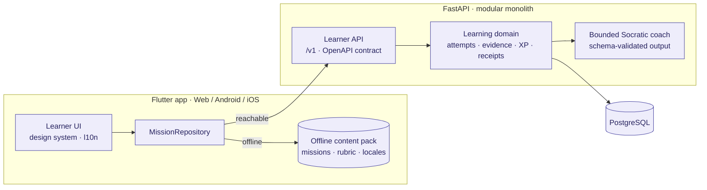

| Layer | Choice | Why |
|---|---|---|
| App | **Flutter / Dart** | One codebase for phone, tablet and laptop, with one design system |
| API | **Python · FastAPI** | A modular monolith ([ADR-001](docs/09-decisions/ADR-001-MODULAR-MONOLITH.md)), deliberately not microservices |
| Data | **PostgreSQL** | Integrity and transactions for attempts, receipts and reports ([ADR-003](docs/09-decisions/ADR-003-POSTGRESQL.md)) |
| Contracts | **OpenAPI + JSON Schema** | Schema-first; both producer and consumer review every change |
| Content | **Versioned scenario packs** | Hash-pinned missions with provenance on every piece of evidence ([ADR-005](docs/09-decisions/ADR-005-SCENARIO-PACKS.md)) |
| AI | **Curated-first Socratic coach** | Bounded by evidence, never a truth oracle ([ADR-004](docs/09-decisions/ADR-004-SOCRATIC-AI.md), [ADR-007](docs/09-decisions/ADR-007-CURATED-FIRST.md)) |
| Delivery | **GitHub Actions · Docker** | Quality gates on every pull request, a pinned web deploy, [container recipes](deploy/README.md) |

**Quality gates.** Every pull request runs Python and Flutter checks, contract and migration validation, PostgreSQL integration tests and security scanning (secrets, SAST, dependency audit, pinned actions). A coach evaluation suite runs on a schedule.

**Design rules baked into the code.** Widgets never touch the network directly; HTTP lives in one client. Features use design tokens, never raw colours. Every status carries an icon, a shape and text. Animation is decoration: everything has a reduced-motion path with the same end state.

### Repository map

| Path | What lives there |
|---|---|
| [`apps/learner`](apps/learner) | The Flutter learner app |
| [`packages/design_system`](packages/design_system) | Tokens, theme, mascots and components |
| [`packages/gameplay`](packages/gameplay) · [`packages/data_access`](packages/data_access) | Progression logic and persistence adapters |
| [`services/api`](services/api) | The FastAPI service |
| [`contracts`](contracts) | OpenAPI and JSON Schemas, the source of truth for producers and consumers |
| [`content/p0-demo-pack`](content/p0-demo-pack) | Launch missions, evidence, rubric, locales, coach policy |
| [`evals/coach`](evals/coach) | Deterministic coach evaluation harness |
| [`deploy`](deploy) | Dockerfiles and hosting notes |
| [`docs`](docs/INDEX.md) | Product, architecture, contracts, security, delivery, design, research |

---

## 🚀 Run it yourself

**The app (works offline, nothing else needed)**

```bash
cd apps/learner
flutter pub get          # Flutter 3.29 or newer
flutter run -d chrome    # resize the window to see phone and laptop layouts
```

On the sign-in screen tap **Use** next to *Learner*, or type `learner` / `evidence2026`.

**The API (optional)**

```bash
cd services/api
python -m venv .venv && source .venv/bin/activate     # Windows: .venv\Scripts\activate
python -m pip install -e ../../packages/gameplay
python -m pip install -e ".[test]"
python -m uvicorn evidence_gym_api.main:app --reload
python -m pytest
```

See the [API README](services/api/README.md) for local sign-in settings and the [learner app README](apps/learner/README.md) for pointing the app at a live API. Containers and hosting are in [`deploy/README.md`](deploy/README.md).

---

## 📚 Documentation

| If you want to… | Start here |
|---|---|
| Understand the product | [Concept](docs/01-product/CONCEPT.md) · [MVP scope](docs/01-product/MVP_SCOPE.md) · [PRD](docs/01-product/PRD.md) · [User journeys](docs/01-product/USER_JOURNEYS.md) |
| Understand the design | [Design system](docs/06-design/DESIGN_SYSTEM.md) · [Mascot and visual language](docs/06-design/MASCOT_AND_VISUAL_LANGUAGE.md) · [Screen reference](docs/06-design/SCREEN_REFERENCE.md) |
| Understand the architecture | [Architecture](docs/02-architecture/ARCHITECTURE.md) · [Contracts](docs/03-contracts/README.md) · [Decisions (ADRs)](docs/09-decisions/README.md) |
| Review safety and privacy | [Security docs](docs/04-security) · [`SECURITY.md`](SECURITY.md) · [Governance](docs/12-governance/README.md) |
| Run a session with learners | [Facilitation kit](docs/14-facilitation/README.md) |
| Read the hackathon submission | [Submission pack](docs/10-submission/README.md) |
| Find anything else | [Documentation index](docs/INDEX.md) |

---

## 👥 The team

Four people, one product.

<table>
<tr>
<td align="center" width="25%">
<a href="https://github.com/astrashenokp"><br><b>Polina Astrashenok</b></a><br>
<sub>Frontend &amp; experience<br>learner app, design system, mascots</sub>
</td>
<td align="center" width="25%">
<a href="https://github.com/rinata-abdurakhimova"><br><b>Rina Abdurakhimova</b></a><br>
<sub>Backend &amp; domain<br>API, learning domain, reports</sub>
</td>
<td align="center" width="25%">
<a href="https://github.com/sofiaprutskya-03"><br><b>Sofia Prutska</b></a><br>
<sub>AI, learning &amp; content<br>missions, evidence, coach policy</sub>
</td>
<td align="center" width="25%">
<a href="https://github.com/Alina8anila"><br><b>Alina</b></a><br>
<sub>Platform, data &amp; reliability<br>evals, CI, persistence</sub>
</td>
</tr>
</table>

Want to contribute? Read [`CONTRIBUTING.md`](CONTRIBUTING.md) and the [Git workflow](docs/05-delivery/GIT_WORKFLOW.md). Found a security problem? Follow [`SECURITY.md`](SECURITY.md). Spotted a mistake in a mission? That is a content correction, not a bug, so please see the [governance docs](docs/12-governance/README.md).

<br>

<div align="center">

**Detectors age. Verification habits transfer.**

<sub>Built for the UNESCO Youth Hackathon 2026 · Third-party assets are listed in <a href="THIRD_PARTY_NOTICES.md">THIRD_PARTY_NOTICES.md</a></sub>

</div>
